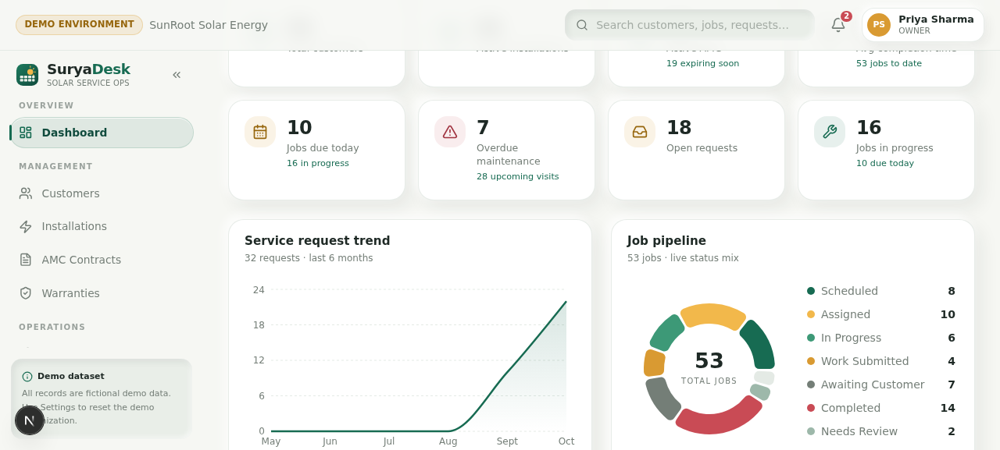

# ☀️ SuryaDesk

**Solar after-sales service management, built for Indian solar installation companies.**

SuryaDesk is the after-sales workspace for solar EPC/O&M companies — customer portal, AMC contracts, preventive maintenance scheduling, field-technician job management, and **OTP-verified proof of service**.



---

## ✨ What it does

| Role | Experience |
|---|---|
| **Owner** | Full company workspace: analytics, request trends, job pipeline, technician workload, AMC renewals, org settings, team & permissions |
| **Manager** | Service request triage (approve/reject/convert), job scheduling & technician assignment, maintenance calendar, customer & installation records, warranties, service reports |
| **Technician** | Mobile-first field app: today's jobs, checklists, photos, service reports with AI draft, **offline sync**, OTP-based customer confirmation |
| **Customer** | Homeowner portal: installations, AMC contract status, raise service requests, service history & verified reports |

### Core flows
- **Service request → job → assignment → field visit → report → OTP confirmation → completed** — a complete, audited lifecycle (every status change is recorded as a timeline event).
- **OTP proof of service**: when a technician submits a report, an SMS OTP is issued to the customer (shown in-UI in demo mode). The job is only marked *Completed* after the customer enters the code — or via an audited manager exception approval.
- **Preventive maintenance**: AMC plans generate recurring maintenance occurrences; managers convert them into scheduled jobs in one click.
- **AI assistant**: triage help and service-report drafting for managers and technicians.

## 🧰 Tech stack

- **Next.js 16** (App Router) + **TypeScript**
- **Tailwind CSS 4** + **shadcn/ui** (New York) + Lucide icons + Framer Motion
- **Prisma ORM** with **SQLite** (local) / **Turso libSQL** (serverless)
- Session auth: bcrypt password hashing + opaque, hashed session tokens (httpOnly cookies)
- State: Zustand + TanStack Query

## 🚀 Quick start (local)

```bash
git clone <your-repo-url> suryadesk
cd suryadesk
bun install          # or: npm install
cp .env.example .env # DATABASE_URL already points at the committed demo database
bun run dev          # or: npm run dev
```

Open http://localhost:3000 — the repo ships with a **fully seeded demo database** (`db/custom.db`), so it works immediately.

### Demo accounts (password for all: `Demo@1234`)

| Role | Name | Email |
|---|---|---|
| Owner | Priya Sharma | `owner@demo.suryadesk.in` |
| Manager | Arjun Mehta | `manager@demo.suryadesk.in` |
| Technician | Ravi Kumar | `tech1@demo.suryadesk.in` |
| Technician | Sunita Verma | `tech2@demo.suryadesk.in` |
| Customer | Anita Deshmukh | `customer@demo.suryadesk.in` |
| Customer | Vikram Rathore | `customer2@demo.suryadesk.in` |

The login screen also has **one-click demo cards** for the four main roles.

### Reset demo data

Signed in as Owner/Manager, the demo organization can be reset to its pristine
seeded state at any time (Settings → demo reset, or `POST /api/demo/reset` with
`{"confirm": "RESET DEMO DATA"}`). This only touches the designated demo
organization — never real data.

## 📦 Deploy to Vercel

> **Important:** Vercel's serverless filesystem is ephemeral — a bundled SQLite
> file cannot persist writes (logins would break). The app supports
> **Turso** (free, serverless SQLite) out of the box: `src/lib/db.ts` switches
> to the libSQL driver automatically when `DATABASE_URL` starts with `libsql:`.

### 1. Push to GitHub

```bash
git init
git add .
git commit -m "SuryaDesk — solar after-sales service management"
git branch -M main
git remote add origin https://github.com/<you>/suryadesk.git
git push -u origin main
```

### 2. Create a free Turso database (2 minutes)

```bash
# Install Turso CLI: https://docs.turso.tech/cli/installation
turso auth signup
turso db create suryadesk
turso db show suryadesk --url          # → libsql://suryadesk-<you>.turso.io
turso db tokens create suryadesk       # → auth token
```

Then push the schema and seed the demo data from your machine:

```bash
DATABASE_URL="libsql://suryadesk-<you>.turso.io" \
DATABASE_AUTH_TOKEN="<token>" \
  bunx prisma db push

DATABASE_URL="libsql://suryadesk-<you>.turso.io" \
DATABASE_AUTH_TOKEN="<token>" \
  bun prisma/seed.ts
```

### 3. Import to Vercel

1. [vercel.com/new](https://vercel.com/new) → import your GitHub repo.
2. Framework preset: **Next.js** (auto-detected). Build command: `next build` (default).
3. Environment variables:
   | Key | Value |
   |---|---|
   | `DATABASE_URL` | `libsql://suryadesk-<you>.turso.io` |
   | `DATABASE_AUTH_TOKEN` | your Turso token |
   | `DEMO_MODE` | `true` |
   | `NEXT_PUBLIC_APP_URL` | `https://<your-app>.vercel.app` |
4. Deploy → your live SuryaDesk demo is ready with the same demo accounts.

## 🗂 Project structure

```
prisma/schema.prisma     # 20+ models: orgs, users, installations, AMC, jobs, reports…
prisma/seed.ts           # demo data seeder (6 users, customers, jobs, full history)
db/custom.db             # committed seeded SQLite demo database
src/lib/surya/           # auth, seed, notifications, OTP, AI, domain types
src/app/api/             # REST API routes (auth, requests, jobs, otp, maintenance…)
src/app/page.tsx         # the app (single route, role-based workspaces)
src/components/suryadesk # login, owner/manager/technician/customer workspaces
public/suryadesk/        # brand assets
```

## ⚠️ Notes & limitations

- **Demo dataset is fictional.** Demo mode shows OTP codes in the UI instead of sending real SMS (set `SMS_PROVIDER`/`SMS_API_KEY` env vars for a real provider).
- SQLite is used for portability; the schema uses string enums and JSON-encoded text fields, and the client transparently upgrades to libSQL (Turso) for serverless deploys.
- Multi-tenant by design: every record is scoped by `organizationId`, enforced in queries.
